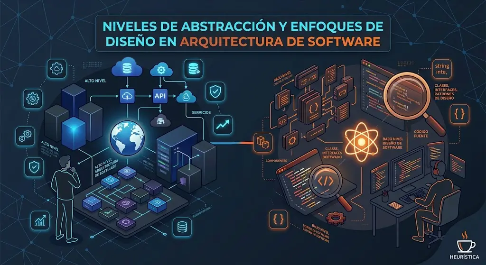

# Artículo

**Nivel:** organismo · **Clases:** `.mx-post-hero`, `.mx-prose`,
`.mx-article-list`

Todo lo necesario para listados y páginas de lectura: el feed de artículos,
el encabezado del artículo, el cuerpo de lectura y el pie con navegación y
recomendados.

## Lista de artículos

```html preview wide
<section class="mx-section" aria-labelledby="ultimos">
  <h2 class="mx-heading" id="ultimos">Últimos artículos</h2>
  <div class="mx-article-list">
    <article class="mx-article-card">
      <a class="mx-article-card__link" href="#">
        
        <h3 class="mx-article-card__title">Autenticación de APIs: Estrategias, Tokens y Buenas Prácticas</h3>
      </a>
      <p class="mx-meta">Por Moisés Baldenegro Melendez • 6 min de lectura</p>
      <p class="mx-article-card__description">Una guía técnica sobre autenticación y autorización en arquitecturas backend modernas.</p>
      <ul class="mx-tag-list"><li class="mx-tag">#api</li><li class="mx-tag">#seguridad</li></ul>
    </article>
  </div>
</section>
```

- Tarjetas en una columna separadas 14px. Detalle en
  [Tarjeta de artículo](/catalog/molecules/cards#tarjeta-de-articulo).

## Encabezado de artículo

```html preview wide
<header class="mx-post-hero">
  
  <div class="mx-post-hero__copy">
    <p class="mx-kicker">#arquitectura</p>
    <h1 class="mx-post-hero__title">Agilismo, diseño y fragilidad</h1>
    <p class="mx-meta mx-meta--pill">Por Moisés Baldenegro Melendez • 4 min de lectura</p>
  </div>
</header>
```

<div class="mx-spec">

| Parte | Valor |
|---|---|
| Contenedor | 2 columnas iguales (1 en ≤ 768px), separación 32px, padding 32px (20px en móvil), borde 1px blanco 15 %, sombra `0 25px 80px rgba(0,0,0,.35)` |
| Fondo | degradado a 160°: `#3C1F44` → `#150A18` (45 %) → `#05050b`, más un brillo radial del acento al 22 % arriba a la derecha y un glow de 640px |
| Línea inferior | 3px, degradado de `#B37AC2` a transparente (70 %) |
| Imagen | 4:3 (16:9 en móvil), borde 1px blanco 15 %, glow `0 0 48px rgba(108,56,122,.35)` |
| Kicker | [`.mx-kicker`](/catalog/atoms/tags), 14px sobre el título |
| Título | Geist Pixel `clamp(2.2rem, 4.5vw, 3.6rem)`, interlineado 1.15, `text-wrap: balance`, sombra de glow |
| Meta | [`.mx-meta--pill`](/catalog/atoms/typography#texto-y-metadatos) |

</div>

## Cuerpo de lectura

```html preview wide
<article class="mx-prose">
  <h2>El falso agilismo: ¿Rapidez o prisa?</h2>
  <p>Muchos ingenieros se han dejado influenciar por el mal uso de las llamadas <strong>metodologías ágiles</strong>. Se confunde el “agilismo” con la “rapidez”.</p>
  <blockquote><p><strong>Producto vs. Proyecto</strong> El software debe verse siempre como un producto.</p></blockquote>
  <h3>1. El nivel macro (Diseño Estratégico)</h3>
  <ul><li>Requisitos funcionales.</li><li>Requisitos no funcionales.</li></ul>
  <p>Usa <code>generateKeyPairSync</code> y lee la <a href="#">documentación oficial</a>.</p>
  <hr>
</article>
```

<div class="mx-spec">

| Elemento | Valor |
|---|---|
| Cuerpo | Geist Sans `clamp(1.0625rem, 1rem + .3vw, 1.1875rem)` (17→19px), interlineado 1.7, `letter-spacing: .01em`, `text-wrap: pretty`, párrafos separados una línea |
| h2 | Geist Pixel 1.75rem (1.4rem en móvil), margen 1.5 líneas arriba y .5 abajo |
| h3 | Geist Sans 1.4rem (1.2rem en móvil) |
| Enlaces | `#B37AC2`, hover `#C396CF` |
| Código en línea | Geist Mono .9em sobre `#101018`, padding 2px 6px |
| Bloques de código | [`.mx-code`](/catalog/molecules/content#bloque-de-codigo) |
| Imágenes | centradas, borde 1px blanco 8 %, sombra de reposo |
| h1 dentro del texto | 1.17em, margen de 1em (el título de la página va en la cabecera) |
| Cita | margen de 1em arriba y abajo y 40px a cada lado |
| Separador | el del navegador: línea en relieve (`border: 1px inset`) gris, margen de 0.5em |
| Ancho | el del contenedor de la página (sin columna estrecha) |

</div>

## Pie del artículo

```html preview wide
<footer class="mx-post-next"><a class="mx-button mx-button--surface" href="#">Siguiente artículo</a></footer>
<section class="mx-post-related" aria-labelledby="recomendados">
  <h2 class="mx-post-related__title" id="recomendados">Recomendados</h2>
  <ul class="mx-result-list">
    <li class="mx-result-row">
      
      <div class="mx-result-row__body"><a class="mx-result-row__link" href="#">Principios del diseño de software</a><p class="mx-result-row__meta">Por Moisés Baldenegro Melendez • 9 min</p></div>
    </li>
  </ul>
</section>
```

- "Siguiente artículo": [botón de superficie](/catalog/atoms/buttons) alineado
  a la derecha (a lo ancho en móvil).
- Recomendados: [filas de resultado](/catalog/molecules/result-row) en 2
  columnas (1 en móvil).
