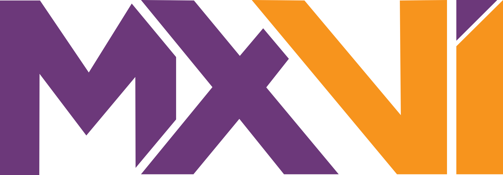

# Footer

**Nivel:** organismo · **Clase:** `.mx-footer`

El footer se puede usar **completo** o **por partes**. Cada parte funciona
sola: el bloque de marca, una columna de enlaces, la lista de redes sociales o
la barra inferior.

## Footer completo

```html preview flush wide
<footer class="mx-footer" style="margin-top:0">
  <div class="mx-footer__inner">
    <div class="mx-footer-brand">
      <a class="mx-logo" href="#"></a>
      <p class="mx-footer-brand__headline">Senior Software Engineer | Backend &amp; Node.js Developer | Systems Architect</p>
      <p class="mx-footer-brand__location"><span aria-hidden="true">◉</span> Guadalajara, Jalisco, México</p>
      <a class="mx-button mx-button--accent" href="#" download>Descargar CV <span aria-hidden="true">↓</span></a>
    </div>
    <nav class="mx-footer__column" aria-label="Navegación">
      <p class="mx-label">Navegación</p>
      <ul class="mx-link-list">
        <li><a class="mx-link mx-link--subtle" href="#">Inicio</a></li>
        <li><a class="mx-link mx-link--subtle" href="#">About</a></li>
        <li><a class="mx-link mx-link--subtle" href="#">Arquitectura</a></li>
        <li><a class="mx-link mx-link--subtle" href="#">Buscar artículos</a></li>
      </ul>
    </nav>
    <section class="mx-footer__column" aria-label="Últimos artículos">
      <p class="mx-label">Últimos artículos</p>
      <ul class="mx-link-list">
        <li><a class="mx-link mx-link--subtle mx-footer__post" href="#">Autenticación de APIs: Estrategias, Tokens y Buenas Prácticas</a><span class="mx-meta mx-meta--mono">27 Octubre 2026 · 6 min</span></li>
        <li><a class="mx-link mx-link--subtle mx-footer__post" href="#">Los 4 desafíos del diseño de sistemas</a><span class="mx-meta mx-meta--mono">23 Octubre 2026 · 4 min</span></li>
      </ul>
    </section>
    <nav class="mx-footer__column" aria-label="Conecta">
      <p class="mx-label">Conecta</p>
      <ul class="mx-link-list">
        <li><a class="mx-link mx-link--subtle mx-social-link" href="#" rel="me noopener"><svg class="mx-social-link__icon" aria-hidden="true" focusable="false"><use href="/mxvi/assets/sprite.svg#github"/></svg>GitHub<span class="mx-visually-hidden"> (sitio externo)</span></a></li>
        <li><a class="mx-link mx-link--subtle mx-social-link" href="#" rel="me noopener"><svg class="mx-social-link__icon" aria-hidden="true" focusable="false"><use href="/mxvi/assets/sprite.svg#linkedin"/></svg>LinkedIn<span class="mx-visually-hidden"> (sitio externo)</span></a></li>
        <li><a class="mx-link mx-link--subtle mx-social-link" href="#" rel="me noopener"><svg class="mx-social-link__icon" aria-hidden="true" focusable="false"><use href="/mxvi/assets/sprite.svg#youtube"/></svg>YouTube<span class="mx-visually-hidden"> (sitio externo)</span></a></li>
        <li><a class="mx-link mx-link--subtle mx-social-link" href="#" rel="me noopener"><svg class="mx-social-link__icon" aria-hidden="true" focusable="false"><use href="/mxvi/assets/sprite.svg#x"/></svg>X<span class="mx-visually-hidden"> (sitio externo)</span></a></li>
      </ul>
    </nav>
  </div>
  <div class="mx-footer-bar">
    <p>© 2026 Moisés Baldenegro Melendez · Hecho con Astro y desplegado en Cloudflare</p>
    <a class="mx-button mx-button--sm" href="#top">Volver arriba <span aria-hidden="true">↑</span></a>
  </div>
</footer>
```

### Especificación visual

<div class="mx-spec">

| Parte | Valor |
|---|---|
| Fondo | glow radial `rgba(108,56,122,.35)` (elipse 60 % × 120 % centrada arriba) sobre un degradado vertical de `#070716` a `#05050b` |
| Borde superior | 1px blanco 15 %; 70px de separación con el contenido anterior |
| Texto base | .92rem `#b8b8c5` |
| Columnas | 1 en < 600px · 2 entre 600 y 899px (la marca ocupa toda la fila) · desde 900px: marca (1.4fr) + 3 columnas iguales |
| Separación | 35px vertical, 28px horizontal; padding 56px arriba, 42px abajo |
| Títulos de columna | [`.mx-label`](/catalog/atoms/typography): Geist Pixel .85rem MAYÚSCULAS, 14px abajo |
| Enlaces | `#b8b8c5`, hover `#C396CF`; título de artículo en `#ffffff`, fecha en Geist Mono .75rem |
| Barra inferior | Geist Mono .78rem, línea superior 1px blanco 8 %, padding 21px; copyright a la izquierda y "Volver arriba" a la derecha (centrados en < 600px) |

</div>

## Partes

### Bloque de marca

Logo de 96px, frase, ubicación con punto de acento y acción principal.

```html preview wide
<div class="mx-footer-brand">
  <a class="mx-logo" href="#"></a>
  <p class="mx-footer-brand__headline">Senior Software Engineer | Backend &amp; Node.js Developer | Systems Architect</p>
  <p class="mx-footer-brand__location"><span aria-hidden="true">◉</span> Guadalajara, Jalisco, México</p>
  <a class="mx-button mx-button--accent" href="#">Descargar CV <span aria-hidden="true">↓</span></a>
</div>
```

- Ancho máximo 34 caracteres; frase en `#ffffff` con interlineado 1.5.
- Ubicación en Geist Mono .8rem; el ◉ en `#B37AC2`.

### Columna de enlaces

```html preview wide
<nav class="mx-footer__column" aria-label="Navegación" style="max-width:280px">
  <p class="mx-label">Navegación</p>
  <ul class="mx-link-list">
    <li><a class="mx-link mx-link--subtle" href="#">Inicio</a></li>
    <li><a class="mx-link mx-link--subtle" href="#">About</a></li>
    <li><a class="mx-link mx-link--subtle" href="#">Arquitectura</a></li>
  </ul>
</nav>
```

### Columna de artículos recientes

```html preview wide
<section class="mx-footer__column" aria-label="Últimos artículos" style="max-width:320px">
  <p class="mx-label">Últimos artículos</p>
  <ul class="mx-link-list">
    <li><a class="mx-link mx-link--subtle mx-footer__post" href="#">Cómo generar una clave privada Ed25519 en una sola línea con Node.js</a><span class="mx-meta mx-meta--mono">27 Octubre 2026 · 3 min</span></li>
    <li><a class="mx-link mx-link--subtle mx-footer__post" href="#">Los 4 desafíos del diseño de sistemas</a><span class="mx-meta mx-meta--mono">23 Octubre 2026 · 4 min</span></li>
  </ul>
</section>
```

### Redes sociales

```html preview wide
<nav class="mx-footer__column" aria-label="Conecta" style="max-width:280px">
  <p class="mx-label">Conecta</p>
  <ul class="mx-link-list">
    <li><a class="mx-link mx-link--subtle mx-social-link" href="#" rel="me noopener"><svg class="mx-social-link__icon" aria-hidden="true" focusable="false"><use href="/mxvi/assets/sprite.svg#github"/></svg>GitHub<span class="mx-visually-hidden"> (sitio externo)</span></a></li>
    <li><a class="mx-link mx-link--subtle mx-social-link" href="#" rel="me noopener"><svg class="mx-social-link__icon" aria-hidden="true" focusable="false"><use href="/mxvi/assets/sprite.svg#linkedin"/></svg>LinkedIn<span class="mx-visually-hidden"> (sitio externo)</span></a></li>
    <li><a class="mx-link mx-link--subtle mx-social-link" href="#" rel="me noopener"><svg class="mx-social-link__icon" aria-hidden="true" focusable="false"><use href="/mxvi/assets/sprite.svg#youtube"/></svg>YouTube<span class="mx-visually-hidden"> (sitio externo)</span></a></li>
    <li><a class="mx-link mx-link--subtle mx-social-link" href="#" rel="me noopener"><svg class="mx-social-link__icon" aria-hidden="true" focusable="false"><use href="/mxvi/assets/sprite.svg#x"/></svg>X<span class="mx-visually-hidden"> (sitio externo)</span></a></li>
  </ul>
</nav>
```

### Barra inferior

```html preview flush wide
<div class="mx-footer-bar">
  <p>© 2026 Moisés Baldenegro Melendez · Hecho con Astro y desplegado en Cloudflare</p>
  <a class="mx-button mx-button--sm" href="#top">Volver arriba <span aria-hidden="true">↑</span></a>
</div>
```

## Accesibilidad

- Las columnas de enlaces son `<nav>` con `aria-label`; la de artículos es
  `<section>`.
- El footer siempre queda al fondo de la página: el `<main>` absorbe el
  espacio libre (`base.css`).
