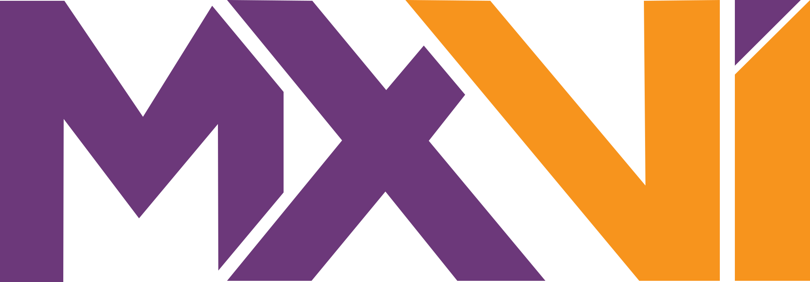

# Navbar

**Nivel:** organismo · **Clase:** `.mx-navbar` · **Compuesta por:**
[logo](/catalog/atoms/media#logo),
[enlaces de navegación](/catalog/molecules/navigation#enlaces-de-navegacion),
[botón de ícono](/catalog/atoms/inputs#boton-de-icono) y
[barra de búsqueda](/catalog/molecules/search)

Barra superior fija de vidrio. En escritorio muestra logo, enlaces y búsqueda
en una fila; en ≤ 969px se convierte en un botón ☰ que despliega un panel con
los enlaces y la búsqueda a lo ancho.

```html preview flush wide
<a class="mx-skip-link" href="#contenido">Saltar al contenido</a>
<header class="mx-navbar">
  <nav class="mx-navbar__inner" aria-label="Principal">
    <a class="mx-logo" href="#" aria-current="page"></a>
    <button class="mx-icon-button mx-navbar__toggle" type="button" data-mx-menu-toggle aria-controls="mx-menu" aria-expanded="false" aria-label="Abrir menú"></button>
    <div class="mx-navbar__menu" id="mx-menu">
      <a class="mx-nav-link" href="#" aria-current="page">About</a>
      <a class="mx-nav-link" href="#">Arquitectura</a>
      <a class="mx-nav-link" href="#">Diseño de sistemas</a>
      <a class="mx-nav-link" href="#">@moibaldenegro</a>
      <search class="mx-search">
        <form class="mx-search__form" action="/search" method="get">
          <svg class="mx-search__icon" aria-hidden="true" focusable="false" width="16" height="16" viewBox="0 0 20 20" fill="none" stroke="currentColor" stroke-width="2" stroke-linecap="round"><circle cx="8.5" cy="8.5" r="7" /><path d="M13.5 13.5 19 19" /></svg>
          <input class="mx-search__input" type="search" name="q" placeholder="Buscar artículos…" aria-label="Buscar artículos">
          <button class="mx-search__clear" type="button" data-mx-clear aria-label="Limpiar búsqueda">×</button>
        </form>
      </search>
    </div>
  </nav>
</header>
<main id="contenido" style="height:380px"></main>
```

## Especificación visual

<div class="mx-spec">

| Parte | Valor |
|---|---|
| Posición | `sticky` arriba, `z-index: 100`; deja de ser sticky con alto de pantalla ≤ 500px |
| Fondo | `rgba(8,8,18,.75)` con `backdrop-filter: blur(18px)` |
| Borde inferior | 1px blanco 15 % |
| Alto | 64px; contenido en `min(1500px, 95%)` centrado |
| Distribución | logo — enlaces (42px entre sí) — búsqueda alineada a la derecha |
| Logo | 72px de ancho |
| Enlaces | Geist Pixel .95rem con subrayado de acento (ver [enlaces](/catalog/molecules/navigation#enlaces-de-navegacion)) |
| Búsqueda | 240px |
| Móvil (≤ 969px) | logo a la izquierda, botón ☰ de 44px a la derecha; el panel aparece debajo con fondo `#070716`, borde inferior 15 %, enlaces de 44px de alto y 1rem, búsqueda a lo ancho; abre con fundido y desplazamiento de 8px |

</div>

## Comportamiento y accesibilidad

- "Saltar al contenido" es el primer elemento: invisible hasta recibir foco,
  aparece arriba a la izquierda con fondo `#B37AC2`.
- El enlace de la página actual lleva `aria-current="page"`.
- Botón ☰/✕ con `aria-expanded` y `aria-controls`; `Escape` cierra el panel y
  devuelve el foco ([contrato de `mxvi.js`](/catalog/install#comportamientos-js)).
- Sin JavaScript, en móvil los enlaces se acomodan en varias líneas y la
  búsqueda ocupa todo el ancho.
- Los enlaces externos llevan "(sitio externo)" oculto.
