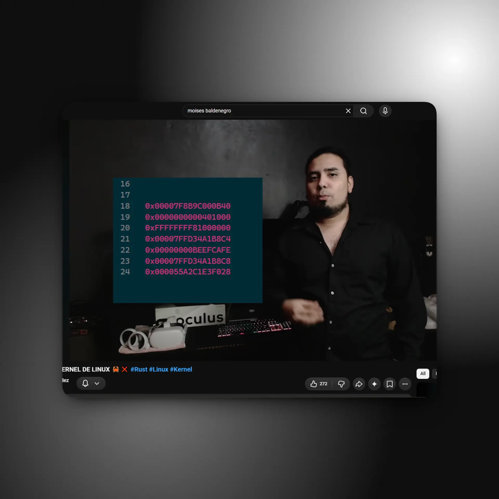

# Promociones y banda de logo

**Nivel:** organismo · **Clases:** `.mx-promo-grid`, `.mx-promo-tile`,
`.mx-logo-band`

## Tarjetas promocionales

Cuadrícula 2 × 2 de proyectos o contenido destacado, al estilo de una tienda:
título grande, subtítulo, dos acciones azules y una imagen que se funde desde
arriba.

```html preview flush wide
<section class="mx-promo-grid" aria-label="Proyectos y contenido">
  <article class="mx-promo-tile" data-tone="youtube">
    <h3 class="mx-promo-tile__title">Rust en el kernel de Linux</h3>
    <p class="mx-promo-tile__subtitle">Programación de sistemas explicada en video, de la memoria al kernel.</p>
    <div class="mx-promo-tile__actions">
      <a class="mx-button mx-button--cta" href="#">Ver en YouTube</a>
      <a class="mx-button mx-button--cta-outline" href="#">Sobre mí</a>
    </div>
    
  </article>
  <article class="mx-promo-tile" data-tone="mfinance">
    <h3 class="mx-promo-tile__title">MFinance</h3>
    <p class="mx-promo-tile__subtitle">Tus finanzas personales, 100 % locales. Tauri, Rust y React.</p>
    <div class="mx-promo-tile__actions">
      <a class="mx-button mx-button--cta" href="#">Ver el código</a>
      <a class="mx-button mx-button--cta-outline" href="#">Más proyectos</a>
    </div>
    
  </article>
</section>
```

<div class="mx-spec">

| Parte | Valor |
|---|---|
| Cuadrícula | 2 columnas (1 en ≤ 768px), separación y padding 10px |
| Tarjeta | alto mínimo 580px (500px en móvil), padding superior 52px (40px), contenido centrado, fondo por tono |
| Tonos (`data-tone`) | `youtube` `#0e0e10` · `mfinance` `#0d1a1d` · `new-relic` `#0e0b22` · `tomatesoft` `#0b0909` |
| Título | Geist Sans 600 `clamp(28px, 3vw, 40px)` |
| Subtítulo | `clamp(17px, 1.6vw, 21px)` `#b8b8c5`, máximo 32 caracteres por línea |
| Acciones | [CTA y CTA contorno](/catalog/atoms/buttons), separación 14px, 16px bajo el subtítulo |
| Imagen | cuadrada, hasta 440px (88 % y 360px en móvil), pegada abajo, se funde de transparente a opaca en el 22 % superior |

</div>

- Es el único lugar donde el azul `#0071e3` aparece como acción.

## Banda de logo

Franja de borde a borde con las cuatro letras del logo como enlaces, en blanco
translúcido sobre la atmósfera morada.

```html preview flush wide
<section class="mx-logo-band" aria-label="MXVI">
  <div class="mx-logo-band__track">
    <a class="mx-logo-band__link" href="#" aria-label="M — GitHub"><svg class="mx-logo-band__logo" viewBox="0 0 717 716" aria-hidden="true" focusable="false"><use href="/mxvi/assets/sprite.svg#mxvi-m"/></svg></a>
    <a class="mx-logo-band__link" href="#" aria-label="X — GitHub"><svg class="mx-logo-band__logo" viewBox="0 0 805 716" aria-hidden="true" focusable="false"><use href="/mxvi/assets/sprite.svg#mxvi-x"/></svg></a>
    <a class="mx-logo-band__link" href="#" aria-label="V — GitHub"><svg class="mx-logo-band__logo" viewBox="0 0 795 716" aria-hidden="true" focusable="false"><use href="/mxvi/assets/sprite.svg#mxvi-v"/></svg></a>
    <a class="mx-logo-band__link" href="#" aria-label="I — GitHub"><svg class="mx-logo-band__logo" viewBox="0 0 190 716" aria-hidden="true" focusable="false"><use href="/mxvi/assets/sprite.svg#mxvi-i"/></svg></a>
  </div>
</section>
```

<div class="mx-spec">

| Parte | Valor |
|---|---|
| Fondo | glow radial central `rgba(108,56,122,.35)` sobre un degradado horizontal `#150A18` → `#3C1F44` → `#150A18` |
| Bordes | 1px blanco 8 % arriba y abajo; padding vertical `clamp(32px, 5vw, 64px)` |
| Letras | 4 columnas (2 en ≤ 768px), alto `clamp(72px, 10vw, 150px)` (64px en móvil), en blanco al 62 % |
| Hover / foco | opacidad 100 %, sube 4px, escala 1.04 y glow de `#B37AC2` |

</div>
